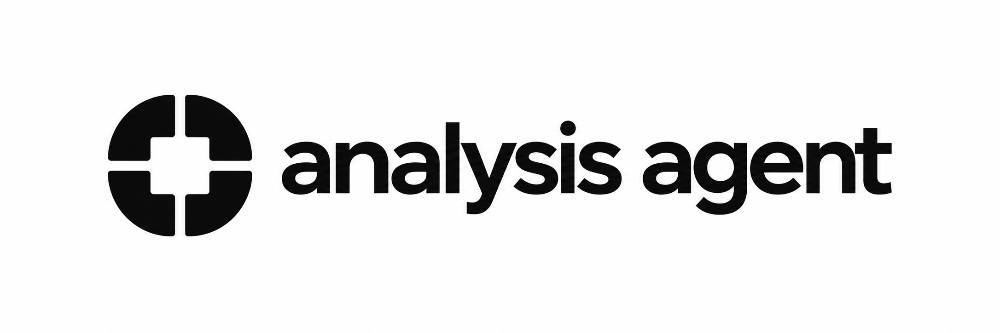

# 

Research a technical question, analyse a proposed change, plan its implementation, audit a repository, explain a topic in HTML, and implement selected outcomes with evidence saved alongside the project. Six skills share common references and a standard reader template.

## Install from GitHub

Choose your client below. These instructions install from [BatuhanTopcu/toolbox](https://github.com/BatuhanTopcu/toolbox). The current release is **0.0.3**.

Have your client and Git installed, then install [Bun](https://bun.sh/docs/installation) **1.4.0 or newer** and make it available on the agent's PATH. Bun runs the artifact helper; 1.4.0 is verified. Check it with:

```sh
bun --version
```

Choose [Codex](#codex), [Claude Code](#claude-code), [Cursor](#cursor), [pi](#pi), or [OpenCode V2](#opencode-v2). Install the complete package: the skills need the sibling `shared/` directory, so copying individual skills or using a sparse checkout breaks their references.

HTML generation requires **Node 24.15+** and **pnpm 10.33.0** for the one-time
public dependency install. After installing the plugin, resolve its loaded root
from the skill's location and run:

```sh
cd /absolute/path/to/loaded/toolbox
pnpm install --frozen-lockfile
```

Install there, including after copied-package updates. Target repositories need
no packages. No report build step or network access is needed to read generated
HTML. Agents check setup and report the exact missing prerequisite.

### Codex

Run in your terminal:

```sh
codex plugin marketplace add https://github.com/BatuhanTopcu/toolbox.git --ref main
codex plugin add toolbox@batu
```

Open a new Codex session in the repository you want to work on. Confirm that `analyse`, `research`, `plan`, `improve`, `explain`, and `implement` are available, then try:

```text
$research explain how this repository handles failed requests
```

Command syntax was checked with Codex CLI 0.159.0. If your CLI has no `plugin` command, update the client first.

### Claude Code

Run in your terminal to install for your user across projects:

```sh
claude plugin marketplace add BatuhanTopcu/toolbox --scope user
claude plugin install toolbox@batu --scope user
```

Start Claude Code in your target repository, or enter `/reload-plugins` in an existing session. Confirm the six namespaced skills, then try:

```text
/toolbox:research explain how this repository handles failed requests
```

See [Claude Code's installation guide](https://code.claude.com/docs/en/plugins/install) for installation scopes and plugin management.

### Cursor

For Cursor's direct GitHub import, enter this in Agent chat:

```text
/add-plugin https://github.com/BatuhanTopcu/toolbox
```

Open **Customize** and confirm the six skills are available. Invoke a skill from the chat's skill picker, or ask the agent to use `explain` to save an HTML walkthrough of the repository.

Cursor support describes this command, but also reports that GitHub-only imports can remain pinned to their initial commit even after reinstalling. See the [support reply](https://forum.cursor.com/t/plugin-update-version-management-how-are-installed-plugins-updated/166454/8). For team distribution, use **Dashboard → Plugins & MCPs → Team Marketplaces → Add Marketplace → Import from Repo**, then install from Customize; this requires Teams or Enterprise. See [Cursor's plugin guide](https://cursor.com/docs/plugins). A complete local checkout for development is documented [below](#local-preview-and-contributing).

### pi

Run in your terminal:

```sh
pi install https://github.com/BatuhanTopcu/toolbox.git
```

Restart pi in your target repository, or enter `/reload`, then try:

```text
/skill:research explain how this repository handles failed requests
```

Pi installs the complete Git package and discovers its six skills through `pi.skills`. Install the public rendering dependencies in that loaded package using the setup above. See pi's [package guide](https://github.com/earendil-works/pi/blob/v0.74.1/packages/coding-agent/docs/packages.md) and [skill commands](https://github.com/earendil-works/pi/blob/v0.74.1/packages/coding-agent/docs/skills.md).

### OpenCode V2

OpenCode V2 loads native skills from configured directories. Clone the complete GitHub package into a persistent location:

```sh
mkdir -p "$HOME/.local/share"
git clone https://github.com/BatuhanTopcu/toolbox.git \
  "$HOME/.local/share/toolbox"
```

From the repository you want to work on, register its skills:

```sh
bun "$HOME/.local/share/toolbox/scripts/configure.mjs" \
  opencode --project "$PWD"
```

The command preserves existing JSON settings and merges one absolute skills path into `opencode.json`. If the project uses `opencode.jsonc`, it prints the entry to merge manually so comments remain intact. Keep the checkout at that location, restart OpenCode, and ask the agent to use `research` for your question.

OpenCode's remote skill sources are HTTP catalogs, so a GitHub repository URL cannot be used directly in the `skills` array. This checkout preserves the package's shared resources. See [OpenCode V2's skills guide](https://opencode.ai/v2/docs/skills#sources).

## Use the skills

Run the agent in the target repository. Analyses are written under `.artifacts/analyse/`; explanations under `.artifacts/explain/`.

| Skill | Use it for | Saved result |
| --- | --- | --- |
| `research` | A bounded technical question and primary-source conclusion | `.artifacts/analyse/research/<slug>/RESEARCH.md` + `RESEARCH.html` |
| `analyse` | A proposed repository change and concrete recommendation | `.artifacts/analyse/change/<slug>/ANALYSIS.md` + `ANALYSIS.html` |
| `plan` | A concise implementation plan grounded in the current repository | `.artifacts/analyse/plan/<slug>/PLAN.md` + `PLAN.html` |
| `improve` | An evidence-backed repository improvement audit | `.artifacts/analyse/improve/<slug>/IMPROVEMENT.md` + `IMPROVEMENT.html` |
| `explain` | A readable saved explanation of a topic or codebase | `.artifacts/explain/<slug>/EXPLANATION.html` only |
| `implement` | Execution of a selected plan, analysis, audit finding, or task | Product changes; MD verification and refreshed HTML only if you accept the closing update question |

A typical Codex workflow is:

```text
$research compare the installed SDK's streaming APIs against its documentation
$analyse assess moving this service to streaming responses using that research
$plan create an implementation plan for the selected streaming recommendation
$implement .artifacts/analyse/plan/streaming-responses/PLAN.md
$explain save an HTML walkthrough of this repository's request lifecycle
```

For an audit, use `$improve audit the payment module for concrete reliability improvements`, then select the findings you want `$implement` to carry out. In Claude Code, replace `$analyse` with `/toolbox:analyse`; in pi, use `/skill:analyse`. The other skill names follow the same pattern.

Use `analyse` for a durable investigation of a change and its alternatives; use `plan` for concrete implementation steps and acceptance checks. Planning can start from a direct request or a selected analysis. Analyses remain directly executable, and ordinary coding requests need no planning artifact.

If the target is absent from the conversation, invoke `implement` without a target. It lists change, plan, and improvement artifacts with their status and asks which artifact and scope to implement. It does not automatically select the latest artifact or execute every finding. A selected plan directory, `PLAN.md`, exact `PLAN.html`, or optional task is accepted directly, without an analysis conversion.

Analyses, plans, and audits create task files only when requested; research creates none. A document marked `ready` is authored and may already contain completed work. Plans stay draft while material execution decisions remain unresolved. Implementation checks the current repository and leaves the artifact untouched while it works. When it finishes, it asks once whether to update the artifact; on yes (or when you asked for a record, or announced a stop to resume later) it records a disposition and actual evidence or proof limit for every selected outcome, plus the current slice and next action so another session can resume, then refreshes the HTML.

The `plan` skill obeys the active harness's permissions; it does not switch the host into native Plan mode. In a session that restricts repository writes, it uses the permitted conversational surface and reports the Toolbox pair as unsaved and unvalidated. In a write-capable session, a plan-only request ends after delivery. An explicit “plan then implement” request continues through `implement` after validating the saved pair, within the same authorization and host permissions.

Markdown carries evidence and agent instructions. HTML teaches the same findings
in six standard sections with public shadcn components, Light/Dark/System themes,
and charts when useful. React finishes static rendering before bundling the final
single file: text, tables, and chart SVGs are already visible with JavaScript
disabled. Hydration adds theme controls and chart interactions. No company UI,
private registry, external assets, or storage is required. See the
[reader contract and build workflow](shared/references/html-reports.md).

The chart component uses public shadcn's Recharts **2.15.4** registry version,
with `react-is` aligned to React 19 and initial dimensions for SSR. The 2.x branch
is inactive upstream. Recharts 3.8.0 and 3.10.1 were tested and produced no static SVG, matching
the open [upstream SSR regression](https://github.com/recharts/recharts/issues/5997).
Version selection is fixed; there is no runtime fallback. The runnable check
requires full chart markup before any future dependency upgrade can pass.

## Update an installation

For Codex, refresh the marketplace snapshot and reinstall from it:

```sh
codex plugin marketplace upgrade batu
codex plugin add toolbox@batu
```

Open a new session and confirm the skills. The second command installs the package again from the refreshed source; see the [Codex installation implementation](https://github.com/openai/codex/blob/444da310e108da16aaeb18fd790b0ac464f08aca/codex-rs/core-plugins/src/manager.rs#L2245).

For Claude Code, refresh the marketplace and installed plugin:

```sh
claude plugin marketplace update batu
claude plugin update toolbox@batu --scope user
```

Then restart Claude Code or enter `/reload-plugins`. Custom marketplaces do not enable auto-update by default. An unchanged manifest version can cause Claude's copied installation to skip an update even when Git has new commits. Local-directory previews load in place. See [Claude's update guide](https://code.claude.com/docs/en/plugins/install#keep-plugins-updated) and [version rules](https://code.claude.com/docs/en/plugins/loading#versions-and-updates).

For pi:

```sh
pi update https://github.com/BatuhanTopcu/toolbox.git
```

Then restart pi or enter `/reload`.

For OpenCode's checkout:

```sh
git -C "$HOME/.local/share/toolbox" pull --ff-only
```

Restart OpenCode after pulling. For Cursor, use your team marketplace's refresh controls; direct GitHub imports have the update limitation described [above](#cursor). Local Cursor checkouts can be pulled with Git and loaded with **Developer: Reload Window**.

## Artifact storage

To keep `.artifacts/` out of Git across repositories, optionally add it to [Git's global ignore file](https://git-scm.com/docs/gitignore). This command preserves existing rules and uses your configured file or Git's default location:

```sh
ignore_file="$(git config --global --path core.excludesFile || true)"
ignore_file="${ignore_file:-${XDG_CONFIG_HOME:-$HOME/.config}/git/ignore}"
mkdir -p "$(dirname "$ignore_file")"
touch "$ignore_file"
grep -qxF '.artifacts/' "$ignore_file" || printf '\n.artifacts/\n' >> "$ignore_file"
```

Git ignore rules do not affect files already tracked. Artifacts remain on disk for review and later implementation.

The skills normally run the artifact helper themselves. To inspect or create artifacts manually, replace `/absolute/path/toolbox` with the complete installed package path and run from your target repository:

```sh
bun /absolute/path/toolbox/shared/scripts/artifact-tool.ts list \
  --repo "$PWD" --json
bun /absolute/path/toolbox/shared/scripts/artifact-tool.ts init \
  --repo "$PWD" --mode change --name streaming-responses
bun /absolute/path/toolbox/shared/scripts/artifact-tool.ts validate \
  "$PWD/.artifacts/analyse/change/streaming-responses"
```

Modes are `change`, `plan`, `improve`, and `research`. `add-task <artifact-dir> --title <title>` is reserved for explicitly requested change/plan/audit tasks; plan tasks use `source: PLAN.md`. Inventory includes invalid artifacts with reasons and creates no index or cache. Unsupported historical layouts are reported without migration.

The current contract is **schema 3**. Whole-artifact validation requires the
canonical HTML sibling and checks its embedded SHA-256 against the final MD.
Editing MD makes HTML stale until rebuilt. `validate --content-only` checks MD
and tasks for authoring/verified presentation repair; it never establishes paired
readiness. Old schemas remain unsupported. Explanations contain only their HTML
and never enter implementation inventory. Failed rendering preserves MD progress
and the last complete HTML, with readiness left invalid.

## Local preview and contributing

Clone the repository when developing or previewing local changes:

```sh
git clone https://github.com/BatuhanTopcu/toolbox.git
cd toolbox
```

For a session-only Claude Code preview:

```sh
claude --plugin-dir "$PWD"
```

For a Codex preview, replace the existing `batu` marketplace source, then install:

```sh
codex plugin remove toolbox@batu
codex plugin marketplace remove batu
codex plugin marketplace add "$PWD"
codex plugin add toolbox@batu --json
```

Omit the removal commands if there is no existing installation. Codex copies
the local package into its plugin cache; it does not load later checkout edits
live. In the returned `installedPath`, run
`pnpm install --force --frozen-lockfile` to rebuild dependency links omitted
when Codex copies the checkout's `node_modules`. Then open a new chat
(restart the app if its skill picker retains the old inventory).
After further edits, run `pnpm validate`, remove/add `toolbox@batu` again, and
repeat that dependency install in the new loaded copy. Keep the marketplace pointed at
the checkout while testing; no GitHub publication is required.

For Cursor, clone the complete repository into its local plugin directory:

```sh
mkdir -p "$HOME/.cursor/plugins/local"
git clone https://github.com/BatuhanTopcu/toolbox.git \
  "$HOME/.cursor/plugins/local/toolbox"
```

Restart Cursor or run **Developer: Reload Window**, then confirm the skills in Customize. Organization policy may require **Allow Local Plugin Imports**. External symlinks are skipped, and an installed marketplace plugin with the same name takes precedence. See [Cursor's local plugin instructions](https://cursor.com/docs/plugins#test-plugins-locally).

Authoring checks require **Node 24.15+**, **pnpm 10.33.0**, and **Bun 1.4.0+** on PATH. From the checkout:

```sh
pnpm install --frozen-lockfile
pnpm validate
```

Edit `plugin.json` for identity, `skills/` for entrypoints, and `shared/` for common resources. `pnpm validate` rebuilds native manifests and package metadata, then checks them. Commit generated files alongside their sources. `pnpm check` verifies freshness without rebuilding.

```text
skills/{analyse,research,plan,improve,explain,implement}/SKILL.md
shared/references/              Workflows and artifact contracts
shared/scripts/artifact-tool.ts Bun artifact commands
shared/scripts/html-report.ts   Full SSR HTML build/validation
shared/html/                    Public UI, renderer, neutral themes, notices
shared/assets/templates/       Main-document, reader, and opt-in task templates
scripts/                       Native registrations, checks, and evaluations
```

Publish the complete package, including hidden manifest directories, shared resources, lockfile, and licenses. Current development version is `0.0.3`; create an immutable version tag when releasing. Bump `plugin.json` for subsequent releases so copied installations can detect updates. Keep entrypoints and shared resources from the same version together.

## Verification

The [GitHub Actions check](.github/workflows/check.yml) installs pinned Node, pnpm, and Bun versions and runs `pnpm check` on pushes and pull requests. Checks cover six registrations, resource links, configuration preservation, schema-3 pairs, plan sections/title/eligibility/optional tasks, stale/missing HTML, historical schema rejection, path escapes, independently installed relocated rendering, complete SSR chart markup, embedded assets/notices, failure cleanup, and same-intent refresh.

These checks establish package structure and helper behavior. Bounded Claude runs on 2026-10-08 discovered all six skills. The restricted Plan-mode case passed source/trace review with no writes and honest unsaved output. An explicit plan → implement run loaded both skills, validated before edits, preserved user work, passed acceptance, and refreshed the pair; it still failed semantic review for overstated baseline evidence. Implicit routing, concise output, and stop/resume compliance also failed in observed cases. These are known model behavior limits, not passing evaluations; the final instruction refinements have not been retested natively. Codex, Cursor, and OpenCode runtime behavior has not been tested for this derivative.

For reproducible behavior checks, follow the [evaluation guide](shared/references/evaluations.md). `pnpm evaluate` prepares fixtures without model calls; `pnpm evaluate --run` executes them in temporary repositories using session-only plugins. Mechanical assertions and source-backed review of consequential claims are separate checks. Keep the before-change package for comparisons and retain failed-run evidence.

## Provenance and license

The package derives from [agent-plugin-template](https://github.com/BatuhanTopcu/agent-plugin-template), retains its MIT notice in [LICENSE](LICENSE), and uses native skill discovery rather than a custom agent runtime. Public shadcn components retain their [MIT notice](shared/html/SHADCN-LICENSE); every generated HTML embeds notices for bundled dependencies. The renderer is independently authored around the standalone SSR workflow; no private builder or company components are bundled.

The workflows use original wording informed by [Matt Pocock's research](https://github.com/mattpocock/skills/blob/d81f3a183412e71a5b1e84ca21bc1a35eea03a60/skills/engineering/research/SKILL.md), [implementation](https://github.com/mattpocock/skills/blob/d81f3a183412e71a5b1e84ca21bc1a35eea03a60/skills/engineering/implement/SKILL.md), [task slicing](https://github.com/mattpocock/skills/blob/d81f3a183412e71a5b1e84ca21bc1a35eea03a60/skills/engineering/to-tickets/SKILL.md), and [shared skill mechanics](https://github.com/mattpocock/skills/blob/d81f3a183412e71a5b1e84ca21bc1a35eea03a60/skills/productivity/writing-for-agents/SKILL-MECHANICS.md); [shadcn's audit](https://github.com/shadcn/improve/blob/cac56e1ebd3c279aa9153616cfeac7b174ab90f9/skills/improve/SKILL.md) and [execution loop](https://github.com/shadcn/improve/blob/cac56e1ebd3c279aa9153616cfeac7b174ab90f9/skills/improve/references/closing-the-loop.md); and [Superpowers plan handoffs](https://github.com/obra/superpowers/blob/8ca22dba9a94f28898bbce59f2537ff4d87c747d/skills/writing-plans/SKILL.md) (new review on 2026-10-01; the original inspiration revision is unknown). They retain this package's local artifacts and explicit target selection rather than importing upstream task indexes, fixed models, or publication workflows.

Implementation planning also draws on [Codex’s decision-complete planning prompt](https://github.com/openai/codex/blob/3b6ab3471a2d4d994c9fad322fca749564bc05e0/codex-rs/collaboration-mode-templates/templates/plan.md) and the [archived ExecPlan cookbook](https://developers.openai.com/cookbook/articles/codex_exec_plans), reviewed on 2026-10-08. The new plan contract uses original wording, the existing schema-3 helper/reader, and each host’s actual permissions; these references add no runtime dependency or native Plan-mode override.

Evaluation, outcome accounting, and resume improvements were informed by [Agent Skills evaluation guidance](https://github.com/agentskills/agentskills/blob/69ef37e9424c0a7ea9dd2293b559e43ec8176379/docs/skill-creation/evaluating-skills.mdx), [description evaluation](https://github.com/agentskills/agentskills/blob/69ef37e9424c0a7ea9dd2293b559e43ec8176379/docs/skill-creation/optimizing-descriptions.mdx), [Anthropic's claim grading](https://github.com/anthropics/skills/blob/8a1541c4a3ffa5a20a5a91de0dcf3f0bab1d1ef4/skills/skill-creator/agents/grader.md), [Spec Kit coverage](https://github.com/github/spec-kit/blob/d2ddd910266ad14afe79c5414c88ee316aca6e9a/templates/commands/analyze.md), [GSD resume](https://github.com/gsd-build/get-shit-done/blob/bdcaab2c752d9a33a1a1ca9acf3a3c81fb991815/get-shit-done/workflows/resume-project.md), and [Superpowers execution records](https://github.com/obra/superpowers/blob/8ca22dba9a94f28898bbce59f2537ff4d87c747d/skills/executing-plans/SKILL.md), reviewed on 2026-10-01. These are design references, not runtime dependencies.

See the [Agent Skills specification](https://agentskills.io/specification), [portable Agent Plugins specification](https://agent-plugins.org/specification), and each host's native installation documentation. The template's MIT notice is retained in LICENSE; upstream workflow collections are design references rather than copied dependencies.
